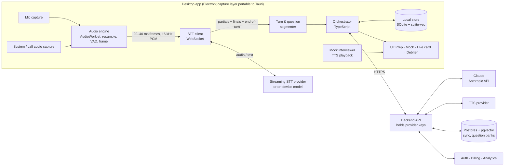

# InterviewHelper — Architecture (v0.1, proposal)

Status: proposal for review. Nothing here is implemented yet.
Date: 2026-10-14

---

## 1. What we are building

InterviewHelper is a real-time interview preparation platform with three modes
that share one speech and intelligence pipeline:

| Mode | What it does | Who is talking |
|---|---|---|
| **Prep** | Turns your résumé, the job description and a short guided conversation into a *talking-points bank*: your stories, projects, numbers, and the two or three points you want to land on each topic. | You and the AI, offline |
| **Mock interview** | The AI plays the interviewer by voice, asks role-specific questions, listens to your spoken answer, and gives immediate structured feedback, a score, and a tighter model version of *your* answer. Weak spots are tracked and drilled with spaced repetition. | You and the AI |
| **Live cues** | Listens to a real conversation, detects when a question has finished, classifies it, and shows a small card with the matching items *from your own bank*: the one-to-three-sentence opener you rehearsed for that story, the keywords to hit after it, and an answer scaffold (STAR, system-design checklist, trade-off framing). | You and a human interviewer |

The same pipeline (audio capture → streaming speech-to-text → turn detection →
question understanding → retrieval → Claude → compact UI) powers all three.
Live cues is only the thinnest slice of it; Prep and Mock are where most of the
product value and most of the engineering live.

### Ground rules baked into the design

- **Cues come from your bank, not from the model's imagination.** The live
  card is retrieval-first. Claude's job in live mode is to classify the question
  and pick the right items. The sentences on the card are openers you wrote
  and rehearsed in prep; the model does not compose new answers to questions
  you did not prepare. If nothing in the bank matches, the card shows only the
  scaffold for that question type. Composed answers exist in mock mode, where
  they teach you, and in a disclosed-use setting where the other party knows
  an assistant is in use.
- **No concealment features.** No eye-movement masking, no hiding from screen
  share, no "look natural" tooling. A visible recording indicator is always on
  while the microphone or system audio is open.
- **Consent and policy are surfaced once, clearly.** First use of live mode
  shows a short notice: recording a call may require the other party's consent
  in your jurisdiction, and some employers prohibit aids. The user decides.
- **Audio is never stored by default.** Transcripts and the bank live locally,
  encrypted at rest. Nothing leaves the device except the audio frames sent to
  the speech provider and the text sent to Claude, and both can be swapped for
  on-device processing in privacy mode.

---

## 2. Feature set

### MVP (phases 0–2)

- Résumé and job-description import; guided "tell me about this project"
  conversation that extracts STAR stories, metrics and talking points.
- Talking-points bank with tags, search, and an "is this still true?" review.
- Rehearsed openers: every story and talking point gets a one-to-three-sentence
  opener, drafted with Claude from your real details, edited by you, and
  rehearsed in mock mode until it sounds like you.
- Mock interview: voice interviewer, role and seniority presets, question bank
  seeded per role (behavioral, technical, system design, situational).
- Per-answer feedback: structure, specificity, metrics, rambling, filler words,
  pace, talk time; a rewritten tighter answer in your own voice.
- Weak-spot tracker with spaced repetition (FSRS scheduler).
- Live cue card: question detected → your rehearsed opener for the best match,
  2–3 keywords to hit after it, scaffold, one-line angle. Compact always-on-top
  panel, keyboard toggle, one-click pause.
- Post-session debrief: full transcript with speaker labels, what you said vs.
  what you planned to say, follow-up questions you were asked, and a draft
  thank-you email.

### Later

- Company brief generator (products, recent news, likely interview themes)
  from the job description and public sources.
- "Questions to ask them" generator tuned to the role and the conversation so far.
- Panel-interview support: multiple interviewer voices, who asked what.
- Coding and system-design practice with a shared whiteboard and rubric.
- Calendar integration: auto-open a 15-minute warm-up before a scheduled interview.
- Mobile companion for flashcard-style drilling of the bank.
- Team / coaching plan: a coach reviews your mock sessions and leaves comments.
- Marketplace of role-specific question packs.

---

## 3. System overview



Two deployment shapes, same code:

- **Personal mode (bring your own keys).** No backend. The app stores your
  Anthropic and speech-provider keys in the OS keychain and calls the providers
  directly. Everything else is local. This is how we run it while building.
- **Hosted mode (for selling).** The backend owns all provider keys, mints
  short-lived tokens for the STT WebSocket, proxies Claude calls, and handles
  accounts, sync and billing. The client never ships a provider key.

---

## 4. Desktop client

### Shell: Electron first, Tauri later if it earns it

- **Electron** (44.x stable, 45 imminent). Since Electron 39 the built-in
  `getDisplayMedia` loopback path captures system audio on Windows through
  WASAPI and on macOS 14.2+ through Core Audio process taps, with ScreenCaptureKit
  on macOS 13–14.1. One TypeScript codebase handles mic, system audio, the UI
  and the orchestrator. Non-activating panel windows (`type: 'panel'`) and
  always-on-top levels are first class.
- **Tauri 2** stays the port target if binary size or CPU matter later. Its
  webview cannot call `getDisplayMedia`, so capture must be written in Rust
  (`wasapi` crate on Windows; Core Audio taps or ScreenCaptureKit on macOS).
  Open-source Tauri meeting recorders (Meetily, Hyprnote) are usable templates.
  The capture layer sits behind one interface so this port does not touch the
  rest of the app.
- **Rejected for now**: browser-only (Chrome-only system audio, a whole-screen
  share prompt every session, no control over panel placement), native Swift
  (macOS only), Flutter (plugin maturity).

### Audio capture, per platform

| Platform | Microphone | Call / system audio | Permission and gotchas |
|---|---|---|---|
| macOS 14.2+ | `getUserMedia` | Electron loopback → Core Audio process taps | `NSMicrophoneUsageDescription` and `NSAudioCaptureUsageDescription` in Info.plist. A missing audio-capture key does not error: buffers arrive silently as zeros. Permission is attributed to the parent process when launched from a terminal or IDE, so test from a packaged build. Appears in Privacy & Security as "System Audio Recording Only". |
| macOS 13–14.1 | `getUserMedia` | Electron loopback → ScreenCaptureKit audio | Needs the Screen Recording permission; Sequoia re-prompts monthly. |
| Windows 10 2004+ / 11 | `getUserMedia` | Electron `setDisplayMediaRequestHandler(..., { audio: 'loopback' })` → WASAPI loopback | No prompt. Per-process loopback (capture only the meeting app) is available natively on build 20348+ and is a Phase 3 refinement. |
| Linux | `getUserMedia` | PipeWire monitor source via a small native helper | No prompt; Electron's own loopback on Linux is unconfirmed. |

**Key design decision: capture two separate channels and keep them separate.**
Mic = you. System audio = interviewer(s). That gives speaker attribution for
free, with no diarization model, no cross-talk confusion and no latency cost.
Both channels are downsampled in an AudioWorklet to 16 kHz PCM16 and sent as
one interleaved stereo stream (Deepgram) or two sockets (other vendors).
The transcript is two aligned streams merged by timestamp. See
"Echo and speaker bleed" in section 5 for the one case where this breaks.

### Windows and panels

- **Live card**: a small, frameless, non-activating panel
  (`type: 'panel'`, `focusable: false`, `alwaysOnTop` at the `screen-saver`
  level, visible on all workspaces and over full-screen apps). Fixed position
  chosen by the user, 3–4 lines max, large type, high contrast. Global hotkeys:
  toggle visibility, pause listening, "next cue", "mark this question for
  debrief". A persistent red dot shows whenever audio is open. The panel is an
  ordinary window as far as screen sharing is concerned; we do not use
  content-protection or exclude-from-capture flags.
- **Mock room**: full window. Interviewer avatar / waveform, live transcript,
  timer, post-answer feedback drawer.
- **Prep & Bank**: full window. Import, guided extraction chat, bank editor,
  tags, review queue.
- **Debrief**: full window. Transcript with speaker lanes, cue history, scores.

---

## 5. Speech pipeline

```
mic ─┐
     ├─► resample 16 kHz mono ─► VAD (Silero, 30 ms) ─► frame buffer ─► STT WS ─► partials/finals
sys ─┘                                                                        │
                                                                              ▼
                                                   end-of-turn signal (provider) ─┐
                                                   silence timer (VAD, ~500 ms) ───┼─► Question segmenter
                                                   semantic completeness check ────┘
```

### Streaming speech-to-text

Vendor landscape as researched on 2026-10-14. Figures are vendor-reported or
third-party benchmark numbers and are inputs to the Phase 0 benchmark, not
conclusions; full notes with sources are in `docs/research/stt-landscape-2026-10.md`.

| Option | End of speech → final | Native end-of-turn | List price | Notes |
|---|---|---|---|---|
| **Deepgram Flux** (default) | median < 300 ms (vendor) | In-model: `EagerEndOfTurn` → `TurnResumed` / `EndOfTurn`, tunable `eot_threshold` (default 0.7) and `eager_eot_threshold` | ≈ $0.46 / hr | The eager event is exactly the hook the speculative path needs. English GA, multilingual variant available. |
| **AssemblyAI Universal-3.6 Pro Realtime** (alternative) | ≈ 150 ms P50 (vendor); best pooled WER in third-party tests (≈ 2.2–2.3 %) | In-model acoustic + semantic, `min_turn_silence` / `max_turn_silence` | ≈ $0.45 / hr | Bills on socket time including idle, so close sockets on pause. |
| OpenAI realtime transcription | ≈ 0.8 s mean (third party) | `semantic_vad` with eagerness levels | ≈ $1.02 / hr | 24 kHz input; no streaming diarization. |
| Speechmatics | ≈ 0.45 s with Voice SDK turn detection | `max_delay` + end-of-utterance trigger | $0.24–0.43 / hr | 50 h / month free tier, handy for development. |
| Google Chirp 3, Azure Speech | not published | VAD events / silence segmentation | ≈ $1 / hr | Measure ourselves if they stay in scope. |
| ElevenLabs Scribe v2 Realtime, Gladia | 150–270 ms partials (vendor) | VAD commit / silence endpointing | $0.39 / $0.75 per hr | Secondary candidates. |

**Two channels on the wire.** Deepgram accepts `multichannel=true&channels=2`
on a single Flux or Nova WebSocket and returns per-channel transcripts and
end-of-turn events, which fits the two-channel design exactly. AssemblyAI
needs one streaming session per channel, so expect roughly double the audio
cost there; OpenAI realtime is mono per session.

On-device options for privacy mode and offline fallback:

- **macOS**: Apple SpeechAnalyzer (macOS 26) with Silero VAD and Smart Turn v3.
  No speaker labels, which the two-channel design makes unnecessary.
- **GPU or Apple Neural Engine**: NVIDIA Nemotron Speech Streaming 0.6B,
  cache-aware with switchable 80–1120 ms chunks and ~24 ms median latency; a
  CoreML port exists.
- **CPU only**: Moonshine v2 streaming (English, tens of ms to first token) or
  whisper.cpp large-v3-turbo with VAD chunking (0.5–2 s behind speech, fine for
  mock mode, marginal for live cues).
- **Windows**: Windows AI Speech Recognition API (public preview, English, NPU
  on Copilot+ PCs, CPU fallback).

Decision for Phase 0: benchmark Deepgram Flux, AssemblyAI 3.6 Pro and one
on-device model on recordings of our own voices and the target roles' jargon.
Selection criteria in order: time from end of speech to final transcript,
quality of native end-of-turn detection, custom vocabulary support, word
timestamps, price per hour, and availability of short-lived tokens for hosted
mode. The STT client is an interface with one adapter per vendor so the choice
is a config change.

Orchestration frameworks (LiveKit Agents, Pipecat) were evaluated and rejected
as a runtime: for a single-user desktop app they add a server and hops without
benefit. We call the STT WebSocket directly and borrow Pipecat's Smart Turn
weights and adapter patterns as libraries.

### Echo and speaker bleed

The two-channel design assumes the interviewer's voice arrives only on the
system-audio channel. On laptop speakers it also reaches the microphone, so
the "you" channel contains the interviewer too. This is the one hard audio
problem in the product and it is handled in layers:

1. **Headphones-first onboarding**, with a live bleed detector that warns when
   interviewer energy shows up on both channels.
2. **Text-level dedupe**: drop mic-channel segments that duplicate recent
   system-channel text (cheap, catches most of it).
3. **Acoustic echo cancellation** using the loopback stream as the far-end
   reference (WebRTC AEC3; the `aec3` Rust crate or a commercial SDK). Delay
   alignment is the fiddly part, so this is Phase 3, not Phase 0.

### Turn detection and question segmentation

A question is "finished" when at least two of three agree:

1. **Provider end-of-turn event** (Flux `EndOfTurn`; AssemblyAI end-of-turn).
2. **Silero VAD v6 silence** on the interviewer channel for ~500–700 ms
   (32 ms chunks, about 1 ms per inference, runs in the audio worklet via ONNX Runtime Web or a native helper).
3. **Semantic completeness**: Smart Turn v3 (8 MB int8 model, ~12 ms on CPU)
   over the last few seconds of audio, plus a cheap text heuristic (trailing
   question mark, leading wh-word). Claude Haiku 5.5 is consulted only when
   these disagree.

Interviewer-channel speech after a cue was issued is treated as a follow-up and
re-segmented; the card updates rather than resetting.

### Speculative execution

Classification and retrieval start on *partial* transcripts as soon as the
interviewer channel has ~1.5 s of speech, and again on Flux `EagerEndOfTurn`
(threshold ≈ 0.5–0.6). `EndOfTurn` confirms and releases the cue;
`TurnResumed` cancels the in-flight request and restarts it with the longer
text. By the time the question actually ends, retrieval is usually done and
only the final cue compression is on the critical path.

---

## 6. Intelligence layer

### The talking-points bank

Local SQLite with `sqlite-vec` for embeddings. Core tables:

- `profile` — target role, seniority, companies, preferences.
- `bank_items` — one row per story / fact / talking point: `kind`
  (story, project, metric, value, weakness, question-to-ask), `title`,
  `body`, `tags[]`, `scaffold` (STAR fields for stories), `opener` (the
  rehearsed one-to-three sentences), `embedding`, `last_reviewed`,
  `confidence`, `rehearsal_count`.
- `questions` — seeded and generated questions, `type`, `tags`, `difficulty`.
- `sessions`, `turns` (speaker, start/end ms, text, channel), `cues`,
  `feedback`, `srs_cards`.

Items are written by the Prep conversation (Claude extracts them from your
answers, asks for the missing numbers, and drafts an opener for you to edit),
by Mock sessions ("that answer was good, save it as the opener"), and by hand.
An opener is marked rehearsed only after you have said it aloud in mock mode
at least twice.

### Claude routes

All calls go through the official Anthropic SDK (`@anthropic-ai/sdk`), with
streaming, adaptive thinking, structured outputs for anything the UI parses,
and prompt caching on the stable prefix (system prompt + rubric + the user's
bank summary). The `fallbacks: "default"` server-side fallback is enabled on
every Opus call so a safeguard decline never leaves the user with an empty card.

| Route | Model | Effort | Why |
|---|---|---|---|
| Question classification (type, tags, completeness) | `claude-haiku-5-5` | low | Hundreds of ms, pennies, runs on partials |
| Live cue compression (pick 2–3 items, write keywords + angle) | `claude-opus-5-5` | low | Best judgment of "which story fits"; low effort keeps first token fast. Measure; try Sonnet 5.5 only if first-token latency misses budget |
| Mock interviewer (next question, follow-ups, persona) | `claude-opus-5-5` | medium | Needs to probe like a real senior interviewer |
| Answer feedback and rewrite | `claude-opus-5-5` | high | Quality matters more than speed here |
| Prep extraction (résumé → bank items, interview-you flow) | `claude-opus-5-5` | high | One-time, accuracy-critical |
| Debrief summary, thank-you email | `claude-opus-5-5` | medium | Background job |

### Live cue contract (structured output)

```json
{
  "question_type": "behavioral | technical | system_design | situational | culture | logistics",
  "tags": ["conflict", "stakeholders"],
  "scaffold": "STAR",
  "opener": {
    "text": "The closest thing I've done is the payments migration last year, where we cut p95 latency by 40%. The hard part wasn't the code, it was getting two teams to agree on the cutover plan.",
    "bank_item_id": "story_12"
  },
  "cues": [
    { "text": "Payments migration — cut p95 latency 40%", "bank_item_id": "story_12" },
    { "text": "Pushed back on scope with data, not opinion", "bank_item_id": "story_12" },
    { "text": "Result: shipped 2 weeks early, zero rollbacks", "bank_item_id": "metric_31" }
  ],
  "angle": "Lead with the outcome, then the trade-off you chose.",
  "confidence": 0.82
}
```

Every cue carries the `bank_item_id` it came from, so the debrief can show which
prepared material you actually used.

### What the card shows: three levels

| Match confidence | Card content | Where it comes from | Time to screen |
|---|---|---|---|
| High (one story clearly fits) | Your rehearsed **opener**, full text, then 2–3 keywords, then the scaffold | Retrieval only, no generation on the critical path | ≈ 0.5 s after end of question |
| Medium (several items fit) | 2–3 **keywords** from the best items plus a one-line angle | Retrieval plus a short Claude compression | ≈ 1.2 s |
| Low (nothing prepared) | **Scaffold** for the question type, nothing else | Static | immediate |

The opener path is the fastest precisely because nothing is being written on
the spot. The sentences were written and rehearsed earlier, so they come back
as your own words under stress. Questions that land on the low level are
logged and become the next mock-mode drill, which is how the bank grows to
cover them.

### Prompt caching layout

```
[tools] → [system: role, rules, output schema] → [bank summary, ~2–6k tokens]  ← cache breakpoint
→ [recent transcript window, last ~8 turns] → [the question]
```

The bank summary changes only when the bank changes, so nearly every live and
mock call is a cache read. `usage.cache_read_input_tokens` is logged per call
and shown in a dev panel so regressions are visible.

### Latency budget (live mode, end of question → first cue on screen)

| Stage | Target | Notes |
|---|---|---|
| Audio framing and transport | ≤ 60 ms | 20–40 ms frames, WebSocket |
| Final transcript after end of speech | 200–500 ms | Provider endpointing; main variable to benchmark |
| Classify + retrieve | ~0 ms on critical path | Done speculatively on partials |
| Cue first token | 300–700 ms | Cached prefix, low effort, streaming |
| Render | ≤ 50 ms | Stream tokens into the card |
| **First cue visible** | **≤ 1.2 s** | ≈ 0.5 s on the rehearsed-opener path |
| **Full card** | **≤ 2.5 s** | |

---

## 7. Mock interview engine

- **Interviewer persona** per role and seniority: question strategy, how hard
  to probe, when to ask follow-ups. Runs as a Claude conversation with the bank
  summary cached, so it can ask about *your* projects, not generic ones.
- **Voice**: streaming TTS (ElevenLabs, Cartesia, or OpenAI TTS; benchmark for
  time-to-first-audio). Barge-in supported: if you start talking, playback stops.
- **Your answer**: same STT pipeline on the mic channel; end-of-turn ends the answer.
- **Feedback rubric** (structured output): structure, specificity, evidence and
  metrics, relevance to the question, concision, confidence markers, filler
  rate, words per minute, talk time. Score 1–5 per dimension plus one
  improvement to focus on next.
- **Rewrite**: a tighter version of what you said, in your words, with the
  missing metric placeholders highlighted so you go find the real numbers.
- **Spaced repetition**: each question–answer pair becomes an FSRS card.
  Low-scoring answers come back sooner. Daily 10-minute drill mode.

---

## 8. Backend (hosted mode)

Required only to sell. Personal mode runs without it.

- **API**: TypeScript (Hono or Fastify) on Node. Endpoints: auth, bank sync,
  question banks, `/v1/classify`, `/v1/cue`, `/v1/mock/turn`, `/v1/feedback`,
  `/v1/stt-token` (short-lived provider token), `/v1/tts`.
- **Data**: Postgres + pgvector for synced banks and shared question packs.
  Redis for session state and rate limits. Object storage only for recordings
  the user explicitly opts to keep, encrypted with a per-user key.
- **Auth and billing**: Clerk or Supabase Auth; Stripe subscriptions with a
  usage-based component for audio minutes.
- **Observability**: OpenTelemetry traces through the SDK, per-route latency
  and token usage dashboards, cache hit rate alerts.
- **Hosting**: single region to start (Fly.io or AWS); the WebSocket to the STT
  provider goes client → provider directly using the short-lived token, so the
  backend is never on the audio path.

---

## 9. Data, privacy and compliance

- Local-first: SQLite database encrypted with SQLCipher; key in OS keychain.
- Audio is streamed and discarded. Optional retention is off by default and
  per-session.
- Recording notice: live mode shows a one-time, dismissable notice about
  consent laws for recording calls and about employer policies on aids, with a
  "show again" setting. A visible indicator is always on while audio is open.
- Provider data handling: pick STT and TTS vendors with no-training and
  zero-retention options for hosted mode; document them in the privacy policy.
- Deletion: one button wipes the local store; hosted accounts get a full export
  and delete endpoint.

---

## 10. Tech stack summary

| Layer | Choice | Alternative |
|---|---|---|
| Desktop shell | Electron (TypeScript + React) | Tauri 2 with a Rust capture crate, when size and CPU matter |
| Audio | Electron loopback capture (WASAPI, Core Audio taps), AudioWorklet downsampling, Silero VAD v6 (ONNX), Smart Turn v3 | Native Rust capture (Meetily as template); Recall.ai Desktop SDK if we buy the capture layer |
| STT | Pluggable: Deepgram Flux (default) / AssemblyAI 3.6 Pro; on-device Apple SpeechAnalyzer, Nemotron Streaming, Moonshine or whisper.cpp | OpenAI realtime, Speechmatics, Google, Azure |
| LLM | Claude via `@anthropic-ai/sdk`: Opus 5.5 primary, Haiku 5.5 for classification | — |
| TTS | ElevenLabs / Cartesia / OpenAI TTS | Platform TTS |
| Local store | SQLite + sqlite-vec + SQLCipher | LanceDB |
| Backend | Node + Hono, Postgres + pgvector, Redis | Python + FastAPI |
| Auth / billing | Clerk or Supabase Auth, Stripe | — |
| Observability | OpenTelemetry | — |

---

## 11. Repository layout (monorepo)

```
InterviewHelper/
  apps/
    desktop/            # Electron app (main = capture + windows, renderer = React UI)
    api/                # Hosted backend (hosted mode only)
  packages/
    orchestrator/       # Turn segmenter, routes to Claude, cue/feedback logic (TS, runs in app and api)
    prompts/            # System prompts, rubrics, JSON schemas (single source of truth)
    stt/                # STT client interface + one adapter per vendor + on-device adapter
    audio/              # Capture interface, AudioWorklet downsampler, VAD, framing; native helpers per OS
    schema/             # Shared types (zod) for bank items, cues, feedback
    srs/                # FSRS scheduler
  docs/
    ARCHITECTURE.md
    DECISIONS/          # ADRs as we make choices
```

---

## 12. Phased plan

| Phase | Weeks | Goal | Exit criteria |
|---|---|---|---|
| **0 · Spike** | 1 | Prove the hard part | Two-channel capture on macOS and Windows; Deepgram Flux, AssemblyAI 3.6 Pro and one on-device model benchmarked on our audio; measured end-of-question → first cue under 1.5 s with Claude; bleed measured on speakers vs headphones |
| **1 · Prep + Bank** | 2 | Build the thing the cues draw from | Résumé/JD import; guided extraction; bank editor; cached bank summary |
| **2 · Mock + Feedback** | 3 | The core product | Voice interviewer, rubric feedback, rewrite, FSRS drills, debrief |
| **3 · Live cues** | 2 | The thin slice on top | Always-on-top card, hotkeys, speculative classification, consent notice, debrief integration |
| **4 · Hosted mode** | 3 | Sellable | Backend, auth, billing, sync, zero-retention vendors, privacy policy, installer signing |

Phase 0 is non-negotiable: everything downstream depends on real latency and
accuracy numbers, not vendor claims.

---

## 13. Risks and open questions

- **End-of-turn detection quality** is the biggest UX risk: fire too early and
  the card is wrong, too late and it is useless. Mitigation: the two-of-three
  rule, speculative retrieval, and card *updates* instead of resets.
- **Accents and domain jargon** degrade STT. Mitigation: custom vocabulary from
  the bank (company names, tech terms) pushed to the STT session.
- **macOS permissions** for system audio are a real onboarding hurdle, and a
  missing Info.plist key fails silently with all-zero audio. Mitigation: a
  guided permission flow with a test tone, a "we hear nothing" detector, and
  testing only from packaged builds.
- **Speaker bleed** (interviewer audible on the mic channel when the user is on
  speakers) corrupts attribution. Mitigation: headphones-first UX, text
  dedupe, AEC3 later. See section 5.
- **Cost per session**: audio minutes plus Claude calls. Mitigation: caching,
  Haiku for the hot classification loop, usage shown to the user.
- **Recording-consent law** varies by jurisdiction; this is the user's
  responsibility, but the product must not hide the fact that it records.
- **Employer policy** on aids: outside our control; we surface it and move on.

---

## 14. Alternatives considered and set aside

- **Buy the capture layer**: Recall.ai's Desktop Recording SDK (botless, detects
  Zoom / Meet / Teams) at roughly $0.50 per recorded hour plus transcription.
  Reasonable if capture turns into a time sink; Electron's built-in loopback
  makes it unnecessary for the MVP.
- **Meeting bots** (Zoom RTMS, Google Meet Media API, Teams media bots): join
  the call as a visible participant. Platform-specific, approval-heavy, and the
  wrong shape for a personal tool.
- **Skip STT, send audio straight to a multimodal realtime model**: one hop
  fewer, but we lose control of turn detection, retrieval grounding and cost,
  and hallucinated transcripts are harder to catch.
- **Voice-agent frameworks** (LiveKit Agents, Pipecat) as the runtime: see
  section 5.

---

## 15. Decisions needed before implementation

1. **Platform first**: macOS, Windows, or both in Phase 0? (Recommend macOS
   first if that is what you interview on; Windows loopback is simpler and can
   follow in days.)
2. **Shell**: Electron (recommended: built-in two-channel capture on Windows and
   macOS, one language) or Tauri 2 from day one (smaller binary, but the
   capture layer must be written in Rust first)?
3. **Mode first**: personal mode with your own API keys (recommended, fastest)
   or hosted from day one?
4. **Mock interviewer voice** in Phase 2, or text-only first and add voice in
   Phase 3?
5. **Target role(s)** for the seed question bank, so Phase 1 has real content.
